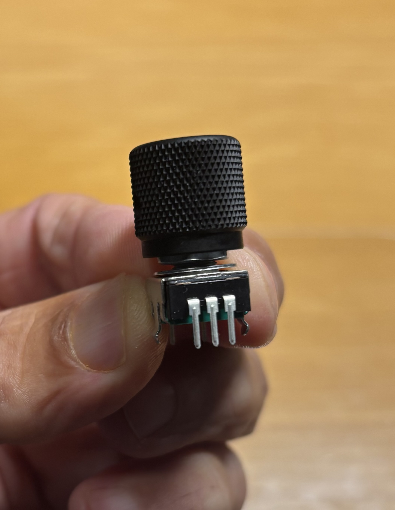
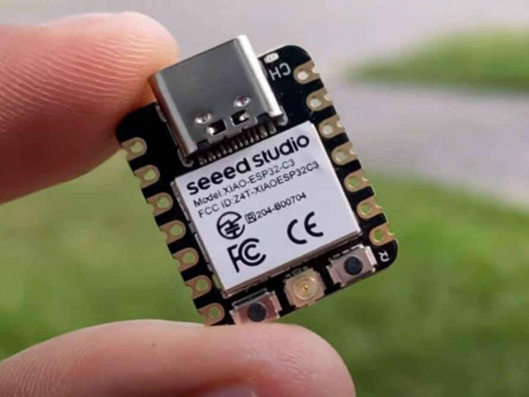

# THE TWINKLER .01™

### Less sleek. Less CLONK. Almost nothing. ✨

Where [THE CLONKER 10000](https://github.com/djacobson/clonker-10000) packs a gloriously oversized remote with beautiful mechanical controls, THE TWINKLER .01™ asks how much machine we can hide underneath just one knob.

<table align="center">
  <tr>
    <td align="center" valign="middle">
      
    </td>
    <td align="center" valign="middle">
      
    </td>
  </tr>
</table>

  The inspiration: one substantial metal knob and one ridiculously tiny Seeed Studio XIAO ESP32C3.

**A miniature, Wi-Fi-connected, one-knob machine. Purpose to be determined.**

---

## The Idea

What if a programmable controller had exactly **one** physical control?

Not a row of buttons. Not a touchscreen. Not even an on/off switch sticking out of the case.

Just one satisfying black metal knob: turn it clockwise, turn it counterclockwise, or press it.

Underneath: a tiny Wi-Fi microcontroller, a very small rechargeable battery, and just enough electronics to make the whole thing work.

All inside a box **smaller than a golf ball**, with only the knob protruding.

What does it do?

**Excellent question. We haven't decided yet.**

## The Rules (For Now)

- **One external control:** a pushable rotary encoder, preferably with a substantial black metal knob.
- **One tiny brain:** a Seeed Studio XIAO ESP32C3 is the initial candidate, not a final commitment.
- **Wireless:** Wi-Fi connectivity, because a knob this small deserves an unreasonable amount of networking capability.
- **Self-contained power:** the smallest practical rechargeable battery and a safe way to charge it.
- **Tiny enclosure:** target a body smaller than a golf ball (approximately 42.7 mm in diameter). The knob may protrude.
- **Display optional:** perhaps a microscopic OLED. Perhaps absolutely nothing.
- **Purpose optional:** no application needs to be invented merely to justify building it.

## The Engineering Puzzle

The processor is probably the easy part.

The interesting problems are mechanical stacking, encoder depth, knob size, battery capacity, antenna placement, charging access, sleep/wake behavior, and keeping the entire assembly pleasant to turn and press.

Wi-Fi power consumption may be the deciding factor in battery life. A device that sleeps most of the time is a very different proposition from one that stays connected continuously.

A pushable encoder offers three basic interactions—clockwise, counterclockwise, and press—before we even consider short presses, long presses, or other gestures.

The challenge is to make the **smallest complete object that's still enjoyable to operate**, not merely the smallest PCB.

## Status

**Concept only.** No finalized schematic, enclosure, battery selection, firmware, or intended application.

This repository is a parking place for sketches, experiments, measurements, and ideas. Nothing here should be mistaken for a validated hardware design.

## The Philosophy

**How much machine can hide underneath one knob?**

It might become useful. It might become absurd. It might just sit on a desk looking mysterious.

Any of those outcomes would be acceptable.

**THE TWINKLER .01™**

*One knob. Infinite opportunities to overengineer it.*
